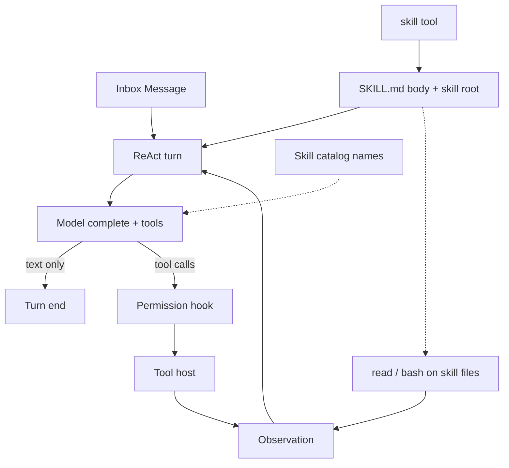

# keel 런타임 설계

조사: [lightweight-agent-runtimes.md](../research/lightweight-agent-runtimes.md).
제품 한 줄: README. 턴 루프 하나가 커널이다. 비동기 자식 완료는 Inbox로 들어온다. 훅은 루프 콜백이다. 도구와 서브에이전트 런처는 호스트다. 크론·채널·대시보드는 아직 없다.

이 문서는 그 커널에 ReAct, 코드 생성·실행, MCP, `SKILL.md`, 세션 저장, CLI를 어떻게 붙일지 정한다.

## 요구

반드시 들어간다.

- ReAct 구조. Thought → Action → Observation을 한 루프가 돌린다.
- 코드를 만들고 실행할 수 있다.
- MCP와 도구를 쓸 수 있다. 도구에는 검색과 코딩이 있다.
- 마크다운 스킬을 쓸 수 있다. 형식은 Agent Skills `SKILL.md`.
- 하나의 대화는 session이다. session은 여러 chat으로 구성된다.
- session과 chat은 로컬 SQLite에 쓴다. 진행 중에는 메모리에 올리고, 읽고, 다시 쓸 수 있다.
- CLI로 새 대화, 이어하기, 목록, 진행 화면을 쓴다.
- LLM은 OpenAI. 웹 검색은 OpenAI hosted `web_search`를 켠다.
- 스킬은 다른 파일을 읽고 스크립트를 실행할 수 있다. 그걸 위해 `read` `bash`가 있어야 한다.

들어가지 않는다. 메시지 타입만 예약한다.

- 채널 어댑터. Slack, Telegram, HTTP UI.
- 대시보드.
- 크론 스케줄러 본체.
- 서브에이전트 프로세스 트리.
- 장기 메모리 플랫폼.
- Docker 샌드박스. `bash` OS jail(Seatbelt/`bwrap`)은 한다.

## 공개 구현에서 고정한 결정

| 결정 | 근거 | 반대로 하지 않는 이유 |
|---|---|---|
| Act는 native tool call | pi, tiny-agents, goose, Rig | 텍스트 `Action: search` 파서는 모델이 도구를 지원하지 않을 때만 |
| 코드 실행의 기본 경로는 bash | mini-swe. 코딩 에이전트 공통 | 커널 안 Python 인터프리터. smolagents CodeAgent |
| MCP는 Tool 소스 | tiny-agents, goose extensions, agentd | MCP 세션을 커널 상태기계로 승격하지 않음 |
| 스킬은 도구가 아니라 지시문 | Agent Skills, pi, goose | `SKILL.md` 본문을 시작부터 시스템 프롬프트에 넣지 않음 |
| 루프만 코어에 둔다 | pi가 하네스를 코어에서 뺀 결정 | Rig/llm-agent-runtime에 루프를 맡기지 않음 |
| 저장 단위 이름은 session | Claude Code, Pi, goose. resume/continue/list | 저장된 대화를 context라고 부르지 않음. context는 모델 입력 창 |
| 로컬 DB는 SQLite | goose, OpenCode. 목록·검색·이어하기 | 세션마다 JSONL만 두면 목록 쿼리가 약함 |
| CLI는 코어 밖 호스트 | pi, goose. 루프는 Event만 냄 | ratatui를 core에 넣지 않음 |
| v1 모델은 OpenAI Responses API | function tool과 hosted `web_search`를 한 요청에 섞음 | Chat Completions만 쓰면 검색을 따로 구현해야 함 |
| 웹 검색은 OpenAI hosted 도구 | [OpenAI web search](https://developers.openai.com/api/docs/guides/tools-web-search) | 모델만 쓴다고 검색되지 않음. Tavily 같은 별도 검색 API는 v1에서 안 씀 |
| 스킬의 파일·실행은 기존 코딩 도구 | Agent Skills `scripts/` `references/`. pi | 스킬 전용 실행기를 만들지 않음 |

## 구조

```text
keel-cli                         호스트. 입력, 권한 확인, 화면
        │
        │ Message / Event
        ▼
┌───────────────┐     ┌────────────┐
│  keel-core    │────▶│ keel-store │  SQLite. session / chat / message
│  Inbox, 루프  │◀────│            │  메모리 WorkingSession과 동기
└───────┬───────┘     └────────────┘
        │ Tool / Skill 인터페이스만
┌───────┴────────┬─────────────┬──────────────┐
▼                ▼             ▼              ▼
keel-tools       keel-mcp      keel-skills    keel-openai
read, bash, …    MCP → Tool    SKILL.md       Responses API
                                              + hosted search
```



커널이 아는 것은 Message, Tool 호출, Event다. OpenAI 키, 검색 엔진, MCP 프로세스, 스킬 파일 시스템, 터미널 UI, SQLite 파일 경로는 모른다. 저장은 `Store`, 모델은 `Model` trait이다.

## 이름: session과 context

하나의 대화 기록은 **session**이다. context가 아니다.

Claude Code, Pi, goose가 저장·이어하기·목록의 이름을 session으로 쓴다. `--continue`, `--resume`, `/session`. Pi 문서 제목도 [Sessions and Context](https://pi.dev/docs/latest/sessions)로 둘을 가른다.

| 말 | 뜻 | 어디에 있나 |
|---|---|---|
| session | 저장된 한 대화. resume 단위 | SQLite `session` 행. 디스크 |
| chat | 그 대화 안의 한 번. 사용자 입력 하나와 이어지는 에이전트 런 | SQLite `chat` 행 |
| message | chat 안의 transcript 한 줄. user, assistant, tool call, tool result | SQLite `message` 행 |
| context | 이번 모델 호출에 실제로 넣는 창 | 메모리. session에서 조립. 전체가 아닐 수 있음 |

context라고 부르면 세 가지와 섞인다. 모델 context window, MCP context, 스킬이 말하는 context. 저장된 대화를 context로 부르지 않는다.

사용자는 “챗 히스토리 = 여러 챗”이라고 했다. 그건 session = 여러 chat이다.

```text
session          이 저장소에서 테스트 고치기
  chat 1         "실패한 테스트 찾아줘"
    message      user / assistant / tool / tool
  chat 2         "그 테스트부터 고쳐"
    message      ...
```

v1은 브랜치·fork를 만들지 않는다. 한 session은 선형 chat 목록이다.

## 메모리와 저장

진행 중 session은 메모리의 `WorkingSession`이다. 디스크만 보고 돌리지 않는다.

```text
resume / new
    → Store.load_session
    → WorkingSession (chats + messages)
    → 매 턴 ContextAssembler가 context를 만듦
    → 루프
    → message가 생기면 Store.append (write-through)
```

`Context`는 타입이다. 테이블이 아니다. 시스템 프롬프트 + AGENTS.md + 스킬 카탈로그 + 최근 message. 한도(`context_limit`의 80%)에 가까우면 오래된 chat을 통째로 빼고 "이전 N개 chat 생략" 안내를 한 번 붙인다. 안내는 저장하지 않는다. 원본 `chat`/`message` 행은 지우지 않는다. 진행 중인 chat은 자르지 않는다. 요약 compaction과 `/compact`는 v2다.

OpenAI에는 `store: false`로 보낸다. 서버에 대화 상태를 두지 않고, 매 호출 context 전체를 보낸다. 그래서 모델 출력 item은 원본 JSON 그대로 저장하고 그대로 다시 보낸다. reasoning과 `web_search_call`도 같다.

동작.

- 새로 시작: `session` insert. 빈 `WorkingSession`.
- 이어하기: id로 load. 메모리에 올린 뒤 다음 `User`를 새 `chat`으로 붙인다.
- 목록: cwd와 `updated_at`으로 `session`만 읽는다. message는 열 때 읽는다.
- 한 chat이 도는 동안 message는 생길 때마다 append한다. 크래시 나도 마지막 observation까지 남는다.

`keel-core`는 `Store`만 본다. SQLite는 `keel-store`다.

## 로컬 DB

파일 하나. `~/.keel/keel.db`. WAL. session에 `cwd`를 두어 워크스페이스별로 거른다. 프로젝트마다 DB 파일을 쪼개지 않는다. 목록과 검색이 한 곳이면 된다.

goose와 OpenCode가 SQLite를 쓰는 이유와 같다. JSONL은 재생은 쉽고 목록·검색은 약하다.

```sql
PRAGMA user_version = 1;                -- 마이그레이션 번호
PRAGMA journal_mode = WAL;
PRAGMA foreign_keys = ON;

CREATE TABLE session (
  id         TEXT PRIMARY KEY,          -- ulid
  title      TEXT,
  cwd        TEXT NOT NULL,
  model      TEXT NOT NULL,
  lock_pid   INTEGER,                   -- 열고 있는 프로세스. 두 곳에서 같은 session을 쓰지 않게
  created_at INTEGER NOT NULL,          -- unix ms
  updated_at INTEGER NOT NULL,
  archived   INTEGER NOT NULL DEFAULT 0
);

CREATE TABLE chat (
  id            TEXT PRIMARY KEY,
  session_id    TEXT NOT NULL REFERENCES session(id) ON DELETE CASCADE,
  seq           INTEGER NOT NULL,       -- session 안 순서. 1부터
  title         TEXT,                   -- 첫 user 한 줄. 목록용
  status        TEXT NOT NULL CHECK (status IN ('running','done','interrupted','error')),
  input_tokens  INTEGER NOT NULL DEFAULT 0,
  output_tokens INTEGER NOT NULL DEFAULT 0,
  created_at    INTEGER NOT NULL,
  ended_at      INTEGER,
  UNIQUE (session_id, seq)
);

CREATE TABLE message (
  id         TEXT PRIMARY KEY,
  chat_id    TEXT NOT NULL REFERENCES chat(id) ON DELETE CASCADE,
  seq        INTEGER NOT NULL,
  role       TEXT NOT NULL,             -- user | assistant | tool | developer
  kind       TEXT NOT NULL,             -- text | reasoning | tool_call | tool_result | hosted_tool | skill | notice
  body       TEXT NOT NULL,             -- keel 정규화 json. 화면과 검색용
  raw        TEXT,                      -- 제공자 원본 item json. 재전송용. 손대지 않음
  provider   TEXT,                      -- 'openai'. raw의 형식
  created_at INTEGER NOT NULL,
  UNIQUE (chat_id, seq)
);

CREATE INDEX idx_session_cwd_updated ON session (cwd, archived, updated_at DESC);
```

`UNIQUE (session_id, seq)`와 `UNIQUE (chat_id, seq)`가 이미 인덱스라 따로 만들지 않는다.

`session.title`은 비어 있게 만들고, 첫 chat의 user 한 줄 또는 `/name`으로 채운다.

열 때 복구한다. `running`으로 남은 chat은 `interrupted`로 바꾸고, 결과 없는 tool call에는 "interrupted" tool result를 합성해 붙인다. 그래야 다음 요청이 OpenAI에서 거부되지 않는다. `lock_pid`가 살아 있는 다른 프로세스면 열지 않는다.

권한 allowlist는 메모리에만 둔다. 다시 열면 다시 묻는다. 필요하면 `session_meta(session_id, key, value)`를 나중에 연다.

v1에 없는 것: fork용 `parent_id`, 메시지 검색 FTS, 원격 동기.

## CLI와 UI 분리

UI와 core는 분리한다. 루프는 Event만 낸다. 화면은 구독한다. 나중에 HTTP나 채널을 붙여도 core는 그대로다.

v1 호스트는 `keel-cli` 하나다. 두 층이다.

1. 명령. 세션을 고른다.
2. 대화 화면. 한 session을 메모리에 올리고 입력을 받는다.

명령.

```text
keel                     이 cwd의 최근 session. 없으면 새로
keel --continue          위와 같음
keel --resume            이 cwd session 목록에서 고름
keel --resume <id>       그 session
keel --new               새 session
keel -p "<prompt>"       print 모드. 새 session에서 chat 하나, 텍스트 델타는 도착하는 대로 stdout
keel session list [--all]
keel session show <id>
keel session rm <id>     archived = 1
```

`-p`는 대화하지 않는다. 텍스트 델타는 도착하는 대로 쓰고, 도구 줄은 쓰지 않는다. 승인이 필요한 도구는 거부로 처리하고, `--allow-edits`면 `write` `edit`만 허용한다. 종료 코드는 0 완료, 1 오류, 2 `max_turns`, 130 취소. 스크립트와 종단 테스트에 쓴다.

대화 화면은 전체 화면 TUI가 아니다. 스트리밍 REPL이다. goose CLI, Claude Code에 가깝다.

- 위: 쌓이는 transcript. user, assistant, tool call, tool result
- 아래: 입력. `/` 명령
- 권한 확인은 입력 줄에서 y/n

슬래시 명령: `/new` `/resume` `/name` `/session` `/skills` `/skill:name` `/last` `/help` `/exit` `/plan`. `/new`와 `/resume`은 REPL 루프 안에서 session을 바꾼다. `/last`는 직전 도구 출력 전문. `/plan`은 plan mode 진입·승인·거부. `/compact`는 예약.

MCP는 `keel-cli` 기동 시 `config.toml`의 서버를 붙여 `Agent.tools`에 넣는다. crate만 두고 연결하지 않으면 안 된다.

키. 실행 중 Ctrl-C는 현재 chat을 취소한다(`interrupted`). 프롬프트에서 Ctrl-C 두 번이나 Ctrl-D는 종료다. 실행 중 끼어들기 입력은 v1에 없다.

ratatui 전체 화면은 v2 호스트다. 같은 Event를 그린다. v1에서 만들지 않는다. crush를 지금 따라가면 커널이 아니라 UI 프로젝트가 된다.

## 커널: ReAct 루프

한 턴은 모델 호출 한 번이다. 한 런은 턴이 `max_turns`에 닿거나 모델이 tool call 없이 끝날 때까지다.

```text
1. Inbox에서 Message를 꺼내 transcript에 붙인다.
2. 시스템 프롬프트를 만든다. 스킬 카탈로그는 name + description만.
3. 등록된 로컬 Tool 스키마와 hosted `web_search`와 transcript로 모델을 부른다.
4. 텍스트만 오면 런 종료. Event: agent_end.
5. hosted `web_search` 결과는 OpenAI가 채운다. transcript에 그대로 붙인다. 로컬 host는 실행하지 않는다.
6. 로컬 tool call이 있으면 각각에 대해
   before_tool → host.execute → after_tool
   결과를 tool result 메시지로 붙인다.
7. 2로 돌아간다.
```

Thought는 모델의 텍스트와 reasoning 블록이다. 별도 `Thought:` 필드를 강제하지 않는다. Action은 tool call이다. Observation은 tool result다. 이게 ReAct다.

한 턴의 Read(`read` `grep` `glob` `skill`)는 병렬이다. Write·Exec·External은 직렬이다. 같은 cwd의 `write` `edit` `bash`는 부모·자식을 포함해 한 줄이다.

훅은 루프 콜백이다. `before_tool`, `after_tool`, `prepare_next_turn`, `should_stop`. 채널이 아니다.

Inbox 메시지 종류.

| 종류 | v1 | 의미 |
|---|---|---|
| `User` | 예 | 사람 입력 |
| `Hook` | 예약 | 외부 훅이 넣은 시스템 이벤트 |
| `Cron` | 예약 | 스케줄이 넣은 작업 |
| `Subagent` | 예 | 비동기 자식 완료 요약. 부모에 tool_result만 |
| `Steer` | 예약 | 진행 중 끼어들기. pi steering queue. v1은 Ctrl-C 취소만 |

커널은 메시지를 구분해서 transcript 역할만 다르게 쓴다. 스케줄러와 서브에이전트 런처는 호스트다.

## 모델: OpenAI

v1 제공자는 OpenAI 하나다. 호출은 [Responses API](https://developers.openai.com/api/docs/guides/tools)다. Chat Completions는 쓰지 않는다.

이유. Responses는 로컬 function tool과 hosted 도구를 한 요청에 같이 넣는다. 코딩 도구는 우리가 실행하고, 웹 검색은 OpenAI가 실행한다.

모델 식별자와 한도는 환경 변수가 정본이다. `LLM_MODEL`, `LLM_BASE_URL`, `LLM_REASONING_EFFORT`, `LLM_MAX_TOKENS`, `LLM_TEMPERATURE`. 키는 `OPENAI_API_KEY`. cwd `.env`를 읽을 수 있다. 설정 파일 `model`은 환경 변수가 없을 때의 기본값이다. `SMALL_LLM_*`는 v1 본 루프에서 쓰지 않는다. 구현은 `keel-openai`가 `Model` trait을 채운다. core는 SDK를 의존하지 않는다. 이름 목록은 `.env.example`과 [REQ-3.8](../planning/srs.md).

쓰지 않는 OpenAI hosted 도구.

- `code_interpreter`, hosted `shell`. 코드 실행은 로컬 `bash`다. 워크스페이스 파일을 원격 컨테이너에 올리지 않는다.
- hosted MCP. MCP는 `keel-mcp`가 로컬에서 연다.

## 도구

모든 도구는 한 trait다. name, description, JSON Schema, `execute(args) -> ToolResult`.

소스는 세 곳이다. 로컬 두 곳은 같은 레지스트리다. hosted 검색은 레지스트리가 아니라 모델 요청에 붙는다.

- `keel-tools`: 코딩 도구. 이 프로세스 안. `read`가 여기 있다. 스킬과 워크스페이스가 같이 쓴다.
- `keel-mcp`: MCP 서버가 광고한 도구. `rmcp`. stdio와 streamable HTTP.
- OpenAI hosted `web_search`: 검색. 로컬 `execute`가 없다.

MCP 도구 이름은 항상 `<server>__<tool>`이다. 그래서 builtin과 겹치지 않는다. 점(`.`)은 function 이름 규칙에서 막힐 수 있어 쓰지 않는다. hosted `web_search`와 로컬 도구 이름은 겹치지 않게 둔다. 로컬에 `web_search` function을 다시 만들지 않는다.

### 코딩

mini-swe의 “bash면 된다”와 goose/pi의 파일 도구를 섞는다. v1 세트.

| 도구 | 하는 일 |
|---|---|
| `bash` | 명령 실행. 생성한 코드의 실행 경로 |
| `read` | 파일 읽기. offset/limit |
| `write` | 파일 쓰기. 생성 |
| `edit` | 부분 수정. `old`가 정확히 한 번 일치해야 `new`로 바꾼다. patch 형식은 받지 않는다 |
| `grep` | 내용 검색 |
| `glob` | 경로 검색 |

작업 디렉터리는 세션 cwd다. `bash`는 그 cwd에서 돈다. 생성과 실행이 같은 공간이다.

권한.

- `read` `grep` `glob`은 기본 허용. 대상은 cwd와, 활성화된 스킬 루트다. 그 밖은 거부하거나 확인.
- `write` `edit`는 cwd만. 스킬 디렉터리에 쓰지 않는다.
- `bash`는 `before_tool` 게이트. 세션 allowlist에 오르면 다음부터 통과.
- 위험 패턴에 걸린 bash는 allowlist에 있어도 항상 확인한다. `rm -rf`, `sudo`, `git push`, `curl`·`wget`·`ssh` 같은 네트워크 명령, 파이프로 셸 실행 등. 명령 문자열을 보는 휴리스틱이라 보안 경계가 아니다.
- 워크스페이스 밖 쓰기는 항상 확인.

`bash`는 OS jail을 쓴다. macOS Seatbelt, Linux `bwrap`. 같은 계층을 Anthropic `sandbox-runtime`이 감싸지만, keel은 그 Node 패키지를 넣지 않는다. jail 안 쓰기는 cwd와 tmp, 네트워크는 끊는다. jail이 없거나 위험 패턴이면 승인 뒤에 호스트에서 돈다. jail 시작 실패는 호스트로 바꾸지 않는다. Docker는 여전히 나중에. 커널은 실행 경로를 모르고 `keel-tools`가 감싼다.

### 검색

OpenAI를 쓴다고 웹이 자동으로 열리지는 않는다. 매 호출 `tools`에 `{ "type": "web_search" }`를 넣어야 한다. 모델이 필요하면 검색하고, 실행은 OpenAI 쪽이다. 결과는 `web_search_call`과 인용 annotation이다. transcript에 남긴다.

v1은 이 경로만 쓴다. Tavily, Bing, MCP 검색 서버는 넣지 않는다. 켜고 끄기는 설정이다.

```toml
[web_search]
enabled = true                                   # 기본
user_location = { type = "approximate", country = "KR" }
search_context_size = "medium"
allowed_domains = []                             # 비우면 제한 없음
```

`user_location`을 빼면 OpenAI는 미국 기준으로 검색한다. 그래서 기본값을 둔다.

코딩 검색은 `grep` `glob`이다. 웹 검색과 섞지 않는다.

## MCP

호스트가 서버 목록을 띄운다. 커널은 연결을 열지 않는다.

```toml
[[mcp.servers]]
name = "filesystem"
transport = "stdio"
command = "npx"
args = ["-y", "@modelcontextprotocol/server-filesystem", "."]

[[mcp.servers]]
name = "search"
transport = "http"
url = "https://mcp.example/search"
headers = { Authorization = "Bearer ${SEARCH_TOKEN}" }   # 비밀은 환경 변수로
```

설정은 `~/.keel/config.toml`과 `<repo>/.keel/config.toml`이다. 프로젝트 쪽이 덮어쓴다. 비밀과 모델 식별자는 설정에 넣지 않고 환경 변수만 읽는다. 우선순위는 [REQ-3.8](../planning/srs.md).

기동 시 `tools/list`를 받아 Tool로 등록한다. 호출은 `tools/call`이다. 서버가 죽으면 그 서버 도구만 에러 observation으로 돌아간다. 루프는 죽지 않는다.

MCP resource subscription, A2A, 샘플링은 v1에 없다.

## 스킬

형식은 [Agent Skills](https://agentskills.io/specification)다. 디렉터리 + `SKILL.md`. frontmatter `name`, `description` 필수.

탐색 순서.

1. `<cwd>/.agents/skills/`
2. git 루트까지 조상의 `.agents/skills/`
3. `~/.agents/skills/`
4. 호환: `.claude/skills/`, `~/.claude/skills/`

같은 이름은 먼저 발견한 것이 이긴다.

progressive disclosure.

1. 기동: 카탈로그. name, description, path. 시스템 프롬프트에 이 목록만 넣는다.
2. 모델이 `skill` 도구를 부르거나 사용자가 `/skill:name`을 주면 `SKILL.md` 본문을 transcript에 붙인다. 결과에 스킬 루트 절대 경로를 넣는다.
3. 본문이 가리키는 다른 파일은 스킬 로더가 넣지 않는다. 모델이 `read` `glob` `grep` `bash`로 연다.

스킬은 도구가 아니다. 지시문과 첨부 디렉터리다. 파일을 읽고 실행하려면 코딩 도구가 있어야 한다. `read`는 그래서 필수다. 이미 코딩 세트에 있다. 스킬 전용 `read_skill_file`은 만들지 않는다.

활성화된 스킬 루트는 그 session의 읽기 allowlist에 올라간다. 본문이 session에 남아 다음 chat에서도 쓰이기 때문이다. resume하면 저장된 skill 메시지에서 다시 채운다. `~/.agents/skills/pdf-tools/references/formats.md`처럼 cwd 밖이어도 `read`가 된다. 그 루트의 `scripts/`는 `bash`로 실행한다. 쓰기는 cwd만.

```text
pdf-tools/
├── SKILL.md                 skill 도구가 본문만 넣음
├── references/formats.md    모델이 read
└── scripts/extract.sh       모델이 bash
```

`SKILL.md`에는 상대 경로를 적는다. 예: `Read references/formats.md before converting.` `Run scripts/extract.sh from the skill root.` 모델은 루트와 `read` `bash`를 이미 알고 있다.

`allowed-tools` frontmatter는 v1에서 읽기만 한다. 강제하지 않는다.

standalone `.md` 한 장 스킬은 v1에서 받지 않는다. `SKILL.md` 디렉터리만.

### AGENTS.md

스킬과 별개로 프로젝트 지시문을 읽는다. `~/.keel/AGENTS.md`, 그다음 git 루트부터 cwd까지 각 디렉터리의 `AGENTS.md`를 바깥에서 안쪽 순서로 시스템 프롬프트에 붙인다. 합쳐서 16,000자를 넘으면 자르고 잘랐다고 적는다. `CLAUDE.md`는 읽지 않는다. tiny-agents와 pi가 같은 파일을 쓴다.

## 크레이트

| crate | 역할 | v1 |
|---|---|---|
| `keel-core` | Message, WorkingSession, Context, ReAct 루프, Event, Store/Tool/Skill trait | 예 |
| `keel-store` | SQLite. session / chat / message | 예 |
| `keel-tools` | 코딩 도구, 권한 게이트. `read`는 스킬 루트도 | 예 |
| `keel-mcp` | MCP → Tool | 예 |
| `keel-openai` | Responses API. function tools + hosted `web_search` | 예 |
| `keel-skills` | 탐색, 카탈로그, `skill` 도구 | 예 |
| `keel-cli` | 명령 + 스트리밍 REPL | 예 |

`keel-core`는 rusqlite, OpenAI SDK, MCP, ratatui, 파일 도구를 의존하지 않는다. 테스트는 fake model, fake tool, in-memory Store로 루프만 돌린다.

## 한 session의 흐름

사용자가 “이 저장소에서 실패한 테스트를 고치고, 관련 이슈 검색해”라고 한다.

1. CLI가 cwd로 최근 session을 열거나 만든다. `WorkingSession`을 메모리에 올린다.
2. 입력이 새 `chat`이 된다. `User` message를 Store에 append하고 Inbox에 넣는다.
3. `ContextAssembler`가 카탈로그와 이전 chat의 context를 만든다.
4. 모델이 `skill(name=rust-test)`를 부른다. 본문이 transcript와 DB에 들어간다.
5. 모델이 `glob`, `grep`, `read`로 코드를 본다.
6. 모델이 OpenAI hosted `web_search`로 이슈를 본다. 실행은 OpenAI다.
7. 모델이 `edit` `write`로 고친다. CLI가 게이트를 한 번 묻는다.
8. 모델이 `bash`로 `cargo test`를 돌린다. 출력이 observation이다.
9. 실패면 5로 돌아간다. 성공 텍스트면 이 chat이 끝난다. 다음 입력은 chat 3이 된다.
10. 프로세스를 꺼도 `keel`이 같은 session을 다시 올린다.

CLI는 Event를 구독만 한다. 커널은 CLI가 누군지 모른다.

## v1 경계

한다.

- native tool call ReAct 루프
- Inbox `User`와 `Subagent`. Ctrl-C 취소(미완료 자식 포함)
- 읽기 도구 병렬, plan mode, `spawn`/`wait` 1단 서브에이전트
- session / chat / message SQLite와 메모리 WorkingSession. chat 단위 생략
- `AGENTS.md`
- `keel -p` print 모드
- OpenAI Responses API. hosted `web_search`
- 코딩 도구 6개와 권한 게이트. `read`는 워크스페이스와 활성 스킬 루트
- MCP 도구 등록
- `SKILL.md` 카탈로그와 `skill` 도구. 첨부 파일은 `read` `bash`
- CLI 명령과 스트리밍 REPL

하지 않는다.

- 텍스트 ReAct 파서
- 서브에이전트 트리(깊이 2+), 크론 본체, 채널, 대시보드, worktree 격리
- 세션 브랜치, fork, ratatui 전체 화면
- 실행 중 끼어들기(Steer), 요약 compaction, `/compact`
- 장기 메모리 계층, 그래프, 워크플로 DAG
- 스킬 본문·references 자동 전체 주입
- 스킬 전용 파일 도구, 커널 안 코드 인터프리터
- OpenAI hosted shell / code_interpreter
- 별도 검색 API, 로컬 `web_search` function
- context라는 이름의 저장 테이블

## 구현 순서

0. spike. `store: false`로 function call → 결과 → `web_search` → reasoning 포함 재전송이, 원본 item을 SQLite JSON으로 왕복한 뒤에도 되는지 확인한다. SSE 이벤트 이름과 function 이름 규칙도 여기서 실측한다.
1. `keel-core` 루프. fake model, fake tool, in-memory Store.
2. `keel-store` SQLite. session load / chat append / message write-through / 복구.
3. `keel-cli` 명령과 REPL. `--resume` `--new` `-p`.
4. `keel-openai`. Responses + 로컬 function tools. 그다음 hosted `web_search`.
5. `keel-tools` `read` `grep` `glob` `bash`. 그다음 `write` `edit`와 게이트.
6. `keel-skills`. 활성 스킬 루트를 `read` allowlist에 넣는다. `AGENTS.md`.
7. `keel-mcp`로 도구를 같은 레지스트리에 합친다.

0이 실패하면 저장 형식부터 다시 정한다. 1이 끝나기 전에 MCP와 스킬을 넣지 않는다. 루프와 저장이 먼저다. 마일스톤과 파트별 상세는 [청사진](../reference/261027-140721-blueprint.md)에 있다.
