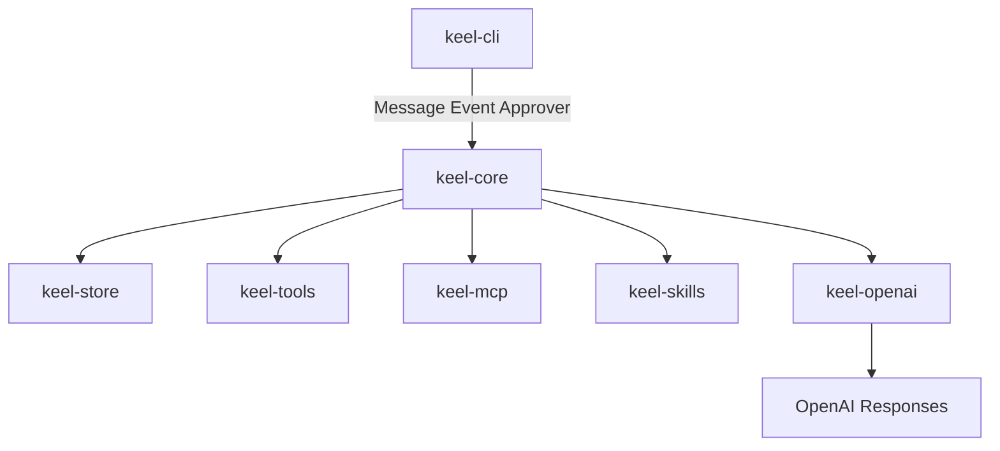

# Software Requirements Specification

keel v1. 권위는 이 문서다. 설계 배경은 [runtime.md](../design/runtime.md), 결정 근거는 [청사진](../reference/261027-140721-blueprint.md).

## 1. 소개

### 1.1 목적

로컬에서 돌아가는 가벼운 Rust 에이전트 런타임을 정의한다. 개발자와 이후 실행 에이전트가 구현·검증할 요구의 정본이다.

### 1.2 범위

v1은 CLI 호스트 하나와 커널 루프 하나를 만든다. 사용자는 워크스페이스에서 대화를 이어 가며 코드를 읽고 고치고 실행하고, 웹을 검색하고, MCP 도구와 `SKILL.md` 스킬을 쓴다. 대화는 로컬 SQLite에 남는다.

보강: 한 턴의 읽기 도구 병렬, plan mode(쓰기 전 승인), 1단 서브에이전트(동기 wait·비동기 spawn). 부모에는 위임 요약만 남기고 자식 본문은 별 session에 둔다. 같은 cwd의 쓰기는 에이전트 경계를 넘어 한 줄이다.

하지 않는다: 채널 어댑터, 대시보드, 크론 본체, 서브에이전트 트리(깊이 2+), 커스텀 에이전트 정의 파일, 에이전트 팀, git worktree 격리, 장기 메모리, Docker 샌드박스, ratatui 전체 화면, 실행 중 끼어들기(Steer), 요약 compaction, planner/executor 이중 모델, 다른 모델 제공자, OpenAI hosted shell/code_interpreter/hosted MCP, 별도 검색 API, 도구 검색 층, 웹/다사용자 호스트.

### 1.3 용어 정의

| 말 | 뜻 |
|---|---|
| session | 저장된 한 대화. resume 단위 |
| chat | session 안의 한 런. 사용자 입력 하나와 이어지는 에이전트 턴들 |
| message | chat transcript 한 줄 |
| context | 이번 모델 호출에 실제로 넣는 입력. 테이블이 아니다 |
| Item | context를 이루는 정규화 단위. 제공자 원본은 `raw` |
| turn | 모델 호출 한 번 |
| run | 한 chat이 끝날 때까지의 턴 열 |
| hosted tool | OpenAI가 실행하는 도구. v1은 `web_search`만 |
| skill | Agent Skills 디렉터리 + `SKILL.md`. 도구가 아니라 지시문 |
| WorkingSession | 열린 session의 메모리 사본. write-through로 DB와 맞춤 |
| plan mode | 읽기만 허용하는 권한 단계. 사람이 계획을 승인한 뒤에 쓰기를 연다 |
| 자식 session | `spawn`이 연 별 session. 부모와 lock을 나누지 않는다 |
| write lock | 같은 cwd의 `write`/`edit`/`bash`를 한 번에 하나만 실행하는 가드 |

## 2. 전체 설명

### 2.1 제품 관점



`keel-core`는 SQLite, HTTP, MCP, 터미널, 파일 도구를 의존하지 않는다. 저장은 `Store`, 모델은 `Model`, 도구는 `Tool`, 승인은 `Approver`다.

### 2.2 제품 기능

- ReAct 루프. Thought는 모델 텍스트/reasoning, Action은 tool call, Observation은 tool result.
- 코딩 도구 6개와 권한 게이트.
- OpenAI hosted 웹 검색.
- MCP 서버 도구 등록.
- `SKILL.md` 카탈로그와 on-demand 본문, `AGENTS.md`.
- session 저장·이어하기·목록, 스트리밍 REPL과 print 모드.
- 읽기 도구 병렬, plan mode, 1단 서브에이전트(`spawn`/`wait`).

### 2.3 사용자 특성

터미널에서 저장소를 다루는 개발자. 한 워크스페이스(cwd)에서 대화를 이어 간다.

### 2.4 제약사항

- 언어: Rust. Cargo workspace, crate 7개.
- 모델 제공자: OpenAI Responses API만. Chat Completions 없음.
- 비밀값: 설정 파일에 두지 않는다. 환경 변수만.
- 대화 상태: OpenAI `store: false`. 로컬 DB가 정본.
- 홈 디렉터리: `KEEL_HOME` (기본 `~/.keel`). 그 아래 `keel.db`, `config.toml`, `history`, `logs/`, `AGENTS.md`.

## 3. 특정 요구사항

### 3.1 기능 요구사항

#### REQ-3.1 커널 루프

한 런은 Inbox에서 `User`를 꺼내 transcript에 붙인 뒤, 모델 호출과 로컬 도구 실행을 `max_turns`(기본 50)까지 반복한다. 모델이 tool call 없이 텍스트만 내면 런을 끝낸다. Act는 native function call이다. 텍스트 ReAct 파서를 만들지 않는다.

#### REQ-3.2 턴과 도구 실행 순서

한 턴은 모델 호출 한 번이다. 한 턴의 여러 로컬 tool call 중 Read(`read` `grep` `glob` `skill`)는 병렬로 실행한다. Write(`write` `edit`), Exec(`bash`), External(MCP)은 직렬이다. 같은 턴에 읽기와 쓰기가 같이 있으면 읽기 묶음이 끝난 뒤 쓰기를 한다. 각 호출은 `before_tool` → 실행 → `after_tool`이다. 병렬 중 취소여도 결과가 없는 `tool_call`에는 `tool_result`를 붙인다(REQ-3.3).

#### REQ-3.3 취소와 짝 맞춤

실행 중 취소는 `CancellationToken`으로 현재 모델 호출과 도구를 끊는다. 모델 스트리밍 도중이든 도구 실행 도중이든, 결과가 없는 `tool_call`에는 `tool_result`를 합성해 붙인다. 짝이 안 맞는 transcript를 모델에 보내지 않는다. 기동 직후·첫 호출 전 취소만 검증해서는 이 요구를 충족한 것이 아니다.

#### REQ-3.4 Inbox와 훅

Inbox는 `User`와 `Subagent`(자식 완료 요약)를 처리한다. `Hook` `Cron` `Steer`는 타입만 예약한다. 훅은 루프 콜백이다: `before_tool`, `after_tool`, `prepare_next_turn`, `should_stop`. `Subagent` 메시지는 부모 transcript에 요약 `tool_result`로만 붙는다. 자식 본문을 펼치지 않는다.

#### REQ-3.5 Event 분리

core는 Event만 낸다. 터미널 I/O와 승인 UI는 `keel-cli`에만 둔다. Event 최소 집합: `RunStart`, `TurnStart`, `TextDelta`, `ToolStart`, `ToolEnd`, `HostedTool`, `ContextTrimmed`, `Usage`, `RunEnd`.

#### REQ-3.6 OpenAI Responses

모델 호출은 `POST /v1/responses` 스트림이다. `store: false`. function tools와 hosted `web_search`를 한 요청에 넣는다. Chat Completions, `previous_response_id`, hosted `shell`/`code_interpreter`/hosted MCP는 쓰지 않는다.

#### REQ-3.7 원본 item 왕복

모델이 돌려준 output item은 손대지 않고 `message.raw`에 저장하고, 다음 요청 input에 그대로 넣는다. 마지막 user 메시지 이후 item을 재작성하지 않는다. 구현은 타입 SDK보다 `reqwest` + SSE + `serde_json::Value`를 기본으로 한다. typed SDK 사용은 M0에서 무손실이 확인된 뒤에만 바꾼다.

#### REQ-3.8 LLM 환경 변수

프로세스는 cwd의 `.env`를 읽을 수 있다. 값은 로그·설정 파일·문서에 쓰지 않는다.

| 변수 | 필수 | 역할 |
|---|---|---|
| `OPENAI_API_KEY` | 예 | 인증 |
| `LLM_MODEL` | 예 | Responses `model` |
| `LLM_BASE_URL` | 아니오 | 기본 `https://api.openai.com/v1` |
| `LLM_REASONING_EFFORT` | 아니오 | 기본 `low` |
| `LLM_MAX_TOKENS` | 아니오 | 기본 `8192` |
| `LLM_TEMPERATURE` | 아니오 | 기본 `0.0` |

우선순위: CLI 플래그 > 환경 변수 > `<repo>/.keel/config.toml` > `~/.keel/config.toml` > 위 기본값. `SMALL_LLM_*`는 v1 본 루프에서 읽지 않는다. 예약이다.

#### REQ-3.9 웹 검색

`[web_search] enabled`가 true면 요청에 `{ "type": "web_search" }`를 붙인다. 기본 true. `user_location` 기본은 `{ type = "approximate", country = "KR" }`이다. 생략하면 제공자가 미국 기준으로 검색한다. 로컬 `web_search` function과 Tavily 등 별도 검색 API는 없다.

#### REQ-3.10 session 모델

저장 단위는 session이다. session은 선형 chat 목록이고, chat은 message 목록이다. fork/`parent_id`는 없다. 저장된 대화를 context라고 부르지 않는다.

#### REQ-3.11 로컬 SQLite

파일은 `$KEEL_HOME/keel.db` 하나다. WAL, `foreign_keys=ON`, `user_version` 마이그레이션. 워크스페이스는 `session.cwd`로 거른다. 프로젝트마다 DB를 쪼개지 않는다. 스키마는 [domain-model.md](../technical/domain-model.md)와 설계서가 정본이다.

#### REQ-3.12 WorkingSession과 write-through

열린 session은 메모리 `WorkingSession`이다. message가 생기면 즉시 `Store.append`한다. 목록은 `session` 행만 읽고, message는 열 때 읽는다.

#### REQ-3.13 열기 복구와 lock

열 때 `status='running'` chat은 `interrupted`로 바꾸고, 짝 없는 tool call에 interrupted result를 합성한다. 끊긴 도구를 재실행하지 않는다. `lock_pid`가 살아 있는 다른 프로세스면 열기를 거부한다. 정상 종료와 취소 종료에서 lock을 푼다.

#### REQ-3.14 context 조립

`ContextAssembler`는 시스템 프롬프트 + `AGENTS.md` + 스킬 카탈로그 + 최근 message로 context를 만든다. 추정 입력이 `context_limit`의 80%를 넘으면 오래된 chat을 통째로 빼고 일회성 Notice를 붙인다. Notice는 저장하지 않는다. 진행 중 chat은 자르지 않는다. 요약 compaction과 `/compact` 동작은 v1에 없다.

#### REQ-3.15 코딩 도구

로컬 도구: `bash`, `read`, `write`, `edit`, `grep`, `glob`. 작업 디렉터리는 session cwd다. `edit`는 `old`가 정확히 한 번 일치할 때만 `new`로 바꾼다. unified patch는 받지 않는다.

#### REQ-3.16 권한

| 클래스 | 기본 |
|---|---|
| Read (`read` `grep` `glob`) | cwd와 session 활성 스킬 루트는 허용. 그 밖은 확인 또는 거부 |
| Write (`write` `edit`) | cwd만. 스킬 디렉터리 쓰기 금지 |
| Exec (`bash`) | 매번 확인. 세션 allowlist(메모리)에 오르면 다음부터 통과 |
| External (MCP) | 매번 확인 |

위험 패턴(`rm -rf`, `sudo`, `git push`, `curl`/`wget`/`ssh`, 파이프 셸 등)은 allowlist에 있어도 다시 묻는다. 이 목록은 휴리스틱이며 보안 경계가 아니다. 경로는 canonicalize 후 검사한다. `--allow-edits`는 Write만 자동 허용한다. `--yolo`는 없다. allowlist는 디스크에 남기지 않는다.

#### REQ-3.17 bash 실행

호출마다 새 프로세스. 프로세스 그룹으로 kill. 타임아웃 기본 120초, 상한 600초. 출력은 30,000자에서 앞뒤를 남긴다. 상태 있는 셸(`cd`/`export` 유지)은 없다. 격리는 REQ-3.25.

#### REQ-3.25 OS jail

`bash`는 가능한 한 OS jail 안에서 돈다. macOS는 Seatbelt(`sandbox-exec`), Linux는 bubblewrap(`bwrap`). Anthropic `sandbox-runtime`(Node)을 의존하지 않고, 그 패키지가 쓰는 것과 같은 OS 도구를 직접 호출한다. jail 안에서는 cwd·임시 디렉터리만 쓰고, 네트워크는 끈다. 위험 패턴이거나 jail을 탐침하지 못하면 호스트에서 돌리기 전에 승인 게이트를 통과해야 한다. jail 기동이 실패하면 호스트로 조용히 폴백하지 않고 에러로 돌린다. `read`/`write`/`edit`는 jail 밖이며 기존 경로 검사를 따른다. Docker·microVM은 이 요구에 없다.

#### REQ-3.18 MCP

설정 `[[mcp.servers]]`의 stdio와 streamable HTTP 서버를 `keel-cli` 기동 시 `tools/list`로 등록하고 `Agent.tools`에 넣는다. 도구 이름은 항상 `<server>__<tool>`이다. 연결 타임아웃 10초. 한 서버 실패는 그 서버 도구의 에러 observation으로만 남기고 루프는 계속한다. MCP crate만 있고 CLI가 연결하지 않으면 이 요구를 충족한 것이 아니다. MCP resources/prompts/sampling은 v1에 없다.

#### REQ-3.19 스킬

형식은 Agent Skills다. 탐색 순서: `<cwd>/.agents/skills/` → git 조상의 `.agents/skills/` → `~/.agents/skills/` → `.claude/skills/`와 `~/.claude/skills/`. 같은 이름은 먼저 발견한 것이 이긴다. 기동 시 name+description 카탈로그만 시스템 프롬프트에 넣는다(상한 4,000자). 본문은 `skill` 도구 또는 `/skill:name`으로 transcript에 붙이고 루트 절대 경로를 같이 준다. 첨부 파일은 스킬 로더가 넣지 않고 모델이 `read`/`bash`로 연다. 활성 스킬 루트는 session 범위 읽기 허용이며, resume 시 저장된 skill 메시지로 복원한다. standalone `.md` 한 장과 `allowed-tools` 강제는 v1에 없다.

#### REQ-3.20 AGENTS.md

`~/.keel/AGENTS.md`와 git 루트부터 cwd까지 각 `AGENTS.md`를 바깥에서 안쪽 순서로 시스템 프롬프트에 붙인다. 합 16,000자를 넘으면 자르고 잘랐다고 적는다. `CLAUDE.md`는 읽지 않는다.

#### REQ-3.21 CLI 명령

```text
keel                     cwd 최근 session. 없으면 새로
keel --continue          위와 같음
keel --resume            cwd 목록에서 고름
keel --resume <id>       지정 session
keel --new               새 session
keel -p "<prompt>"       print 모드
keel session list [--all]
keel session show <id>
keel session rm <id>
```

#### REQ-3.22 REPL

스트리밍 REPL. 텍스트 델타는 도착하는 대로 stdout에 쓰고 flush한다. 모델 SSE를 버퍼링한 뒤 한 번에 그리지 않는다. 마크다운 렌더링과 ratatui는 없다. 도구는 한 줄 요약, `/last`는 직전 도구 출력 전문이다. 승인: `[y]es [a]lways [n]o`. 실행 중 Ctrl-C는 chat을 `interrupted`로 끝낸다. 프롬프트에서 Ctrl-C 두 번 또는 Ctrl-D는 lock을 풀고 종료. 슬래시: `/new` `/resume` `/name` `/session` `/skills` `/skill:name` `/last` `/help` `/exit` `/plan`. `/new`와 `/resume`은 프로세스 재시작 없이 루프 안에서 session을 바꾸고, help에만 있으면 안 된다. `/plan`은 plan mode로 들어가거나, 제시된 계획을 승인·거부한다. `/compact`는 "v2 예정"만.

#### REQ-3.23 print 모드

`keel -p`는 새 session에서 chat 하나 돌린다. 어시스턴트 텍스트 델타는 도착하는 대로 stdout에 쓴다. 도구 줄·승인 UI는 쓰지 않는다. 승인이 필요한 도구는 거부한다. `--allow-edits`면 Write만 허용. 종료 코드: 0 완료, 1 오류, 2 `max_turns`, 130 취소.

#### REQ-3.24 설정 파일

TOML. `~/.keel/config.toml`을 `<repo>/.keel/config.toml`이 덮어쓴다. API 키와 토큰을 넣지 않는다. MCP 헤더의 비밀은 `${VAR}`로만 참조한다. 처음 보는 프로젝트 config는 MCP 기동 전에 한 번 확인한다.

#### REQ-3.26 plan mode

plan mode에서는 Read 클래스만 실행한다. Write·Exec·External은 승인 UI 없이 거부 observation이다. 사람이 `/plan`으로 승인하기 전에는 쓰기를 열지 않는다. 승인은 같은 session에서 일반 권한(REQ-3.16)으로 돌아간다. 계획 텍스트는 어시스턴트 메시지다. 별도 체크리스트 도구와 요약 compaction은 없다. print 모드(`-p`)는 plan mode를 쓰지 않는다.

#### REQ-3.27 1단 서브에이전트

부모 모델은 `spawn`과 `wait` 도구만 쓴다. 호스트가 자식 `Agent::run`을 **새 session**에서 연다. 깊이 1. 자식은 `spawn`/`wait`를 갖지 않는다. 동시에 도는 자식은 최대 4개다. 모델이 위임을 요청할 때만 쓴다. 매 턴 자동 팬아웃은 없다.

- `spawn`: 인자 `task`(필수), `wait`(기본 false). `wait=true`면 이 턴에서 끝날 때까지 막고 요약을 `tool_result`로 붙인다. `wait=false`면 자식 id를 바로 돌려주고 부모 턴은 계속한다.
- `wait`: 인자 `ids`(생략 시 이 부모가 연 미완료 자식). 끝나면 각 자식의 요약 `tool_result`를 붙인다.
- 비동기 완료가 부모 턴 사이면 Inbox `Subagent`로 요약을 넣는다(REQ-3.4).
- 부모 context와 `/last`는 요약(+ 자식 session id)만. 자식의 `tool_call`/`tool_result`는 자식 session에만 있다. 새 `ItemKind`는 만들지 않는다.
- 자식의 승인 프롬프트는 부모 REPL로 올린다. 거절은 그 자식의 observation이다.
- print 모드는 `spawn`을 거부한다.
- 런처는 호스트다. 커널에 두 번째 상태기계를 두지 않는다.

#### REQ-3.28 cwd write lock

같은 session cwd에서 `write` `edit` `bash`는 부모와 자식을 포함해 한 번에 하나만 실행한다. 둘째는 첫째가 끝날 때까지 기다린다. Read는 lock을 잡지 않는다. git worktree로 cwd를 나누지 않는다.

### 3.2 비기능 요구사항

#### REQ-4.1 crate 경계

workspace: `keel-core`, `keel-store`, `keel-openai`, `keel-tools`, `keel-mcp`, `keel-skills`, `keel-cli`. core는 rusqlite, reqwest, rmcp, clap, rustyline, 파일/프로세스 도구를 의존하지 않는다.

#### REQ-4.2 로그

`tracing`은 `$KEEL_HOME/logs/keel-YYYYMMDD.log`에만 쓴다. 터미널에 디버그 로그를 쓰지 않는다. 요청 본문은 debug에서만, 키는 마스킹. `KEEL_LOG=debug`로 수준을 올린다.

#### REQ-4.3 테스트

루프·저장·권한은 `ScriptedModel` + `MemoryStore` + fake Tool로 검증한다. 실제 OpenAI 호출은 `KEEL_LIVE=1`일 때만. 모델이 로컬 도구를 고르는 경로도 `KEEL_LIVE` 테스트로 고정한다. 테스트 이름에 관련 요구 ID를 넣는다.

#### REQ-4.4 오류 처리

라이브러리 crate는 `thiserror`, cli는 `anyhow`. OpenAI 401은 즉시 실패. 429/5xx는 지수 백오프 최대 3회. context overflow는 chat을 더 빼고 1회 재시도. 상세는 [error-model.md](../technical/error-model.md).

### 3.3 데이터베이스 요구사항

#### REQ-5.1 스키마 v1

`session(id, title, cwd, model, lock_pid, created_at, updated_at, archived)`, `chat(..., status, input_tokens, output_tokens, ended_at)`, `message(..., role, kind, body, raw, provider)`. kind: `text` `reasoning` `tool_call` `tool_result` `hosted_tool` `skill` `notice`. 식별자는 ULID. 시각은 unix ms.

#### REQ-5.2 제목

`session.title`은 비워 두고 첫 chat의 user 한 줄 또는 `/name`으로 채운다.

## 4. 품질 속성

- 복구: 크래시 뒤에도 짝 맞는 transcript로 이어갈 수 있다.
- 격리: MCP 서버 하나가 죽어도 런은 산다. 자식 본문은 부모 context에 들어오지 않는다.
- 토큰: 오래된 chat 생략으로 한도를 지킨다. 요약 호출은 하지 않는다.
- 비밀: 키와 토큰이 레포 설정·로그에 남지 않는다.
