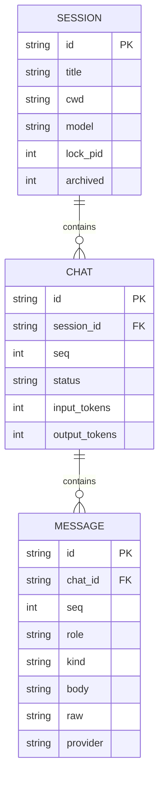
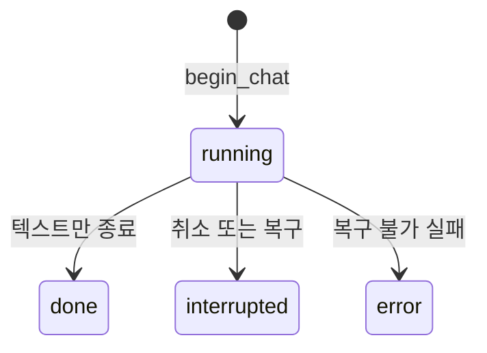

# Domain model

권위: [srs.md](../planning/srs.md) REQ-3.10–3.14, REQ-5.1. 스키마 SQL은 [runtime.md](../design/runtime.md) 「로컬 DB」.

## 엔티티

| 엔티티 | 수명 | 비고 |
|---|---|---|
| Session | 디스크. `archived=1`이면 목록 기본에서 숨김 | cwd + updated_at으로 거름 |
| Chat | Session에 종속. CASCADE | status: running / done / interrupted / error |
| Message | Chat에 종속. CASCADE | `body`는 화면용 정규화, `raw`는 제공자 원본 |
| WorkingSession | 프로세스 메모리 | meta + chats + read_roots + allow(메모리 only) |
| Context | 호출마다 조립 | 저장하지 않음 |
| SkillRoot | session read_roots | skill 메시지로 복원 |

`Context`와 allowlist는 테이블이 아니다. 자식 session은 별 `session` 행이다. `parent_id` 컬럼은 없다. 부모→자식 연결은 부모 `tool_result` 본문의 자식 id다.

## 관계 규칙

- 한 Session의 Chat `seq`는 1부터 연속 유일.
- 한 Chat의 Message `seq`는 1부터 연속 유일.
- 한 Session은 동시에 한 프로세스만 연다(`lock_pid`).
- 활성 스킬 루트는 Session 범위다. Chat이 바뀌어도 유지된다.

## 상태

